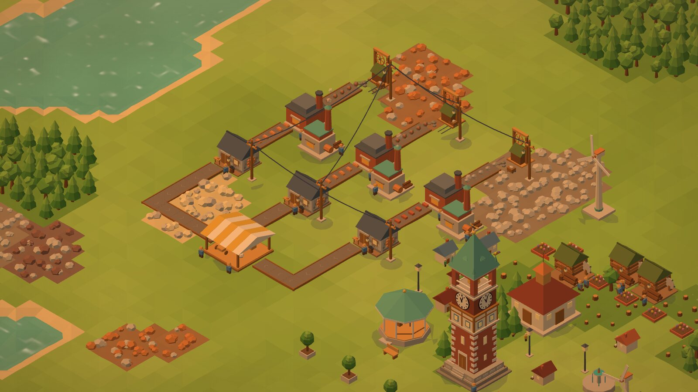
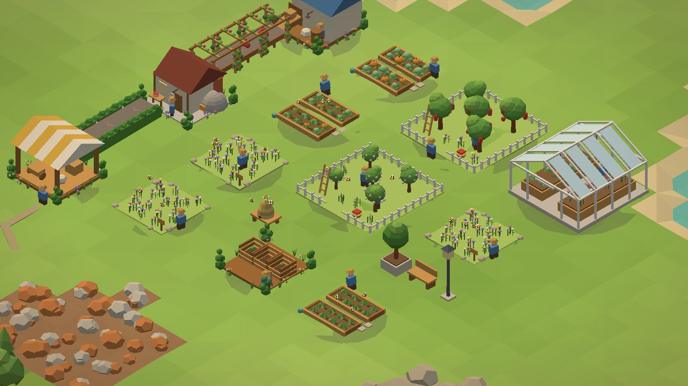
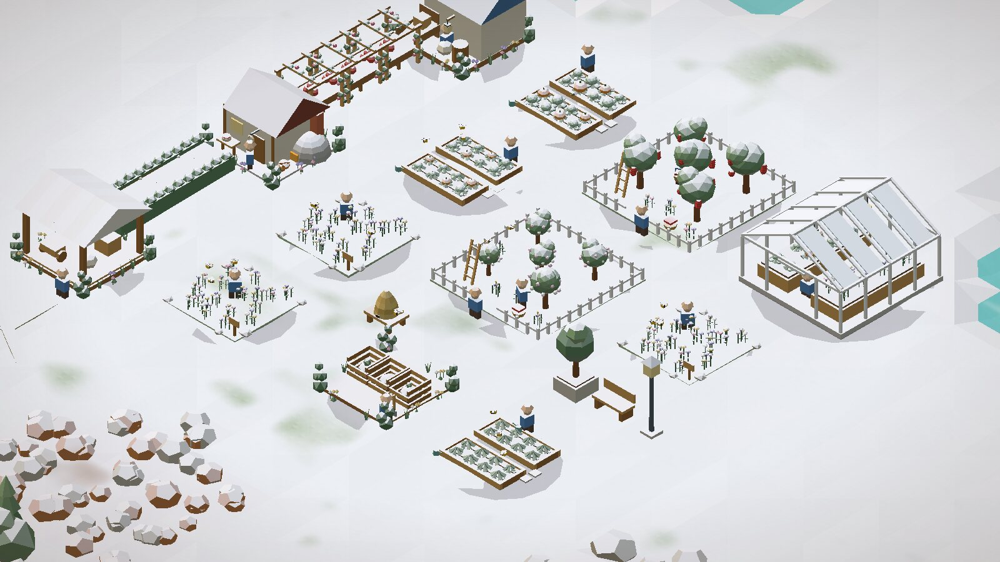
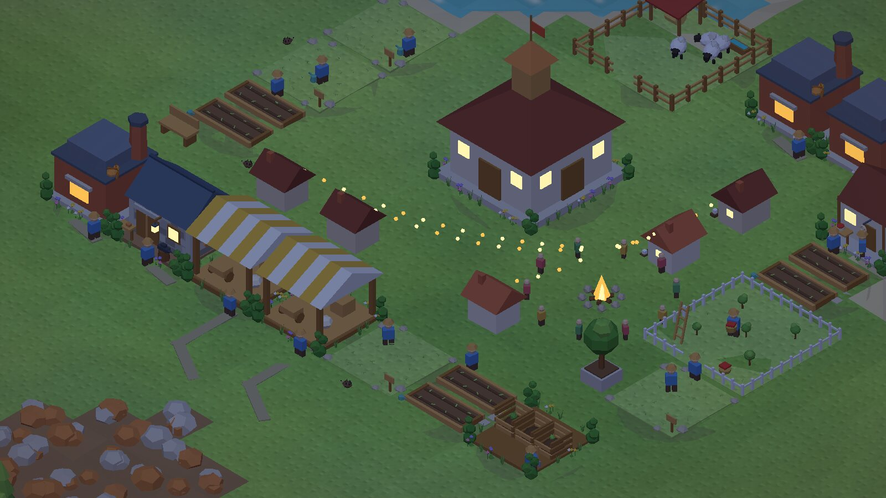
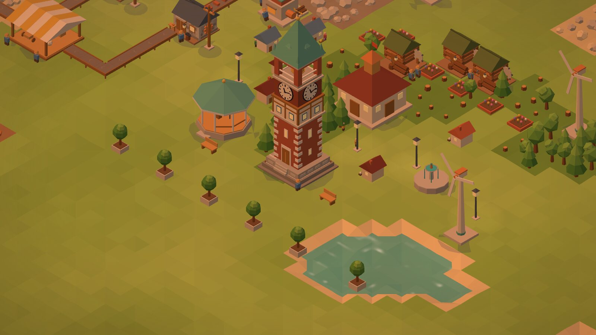
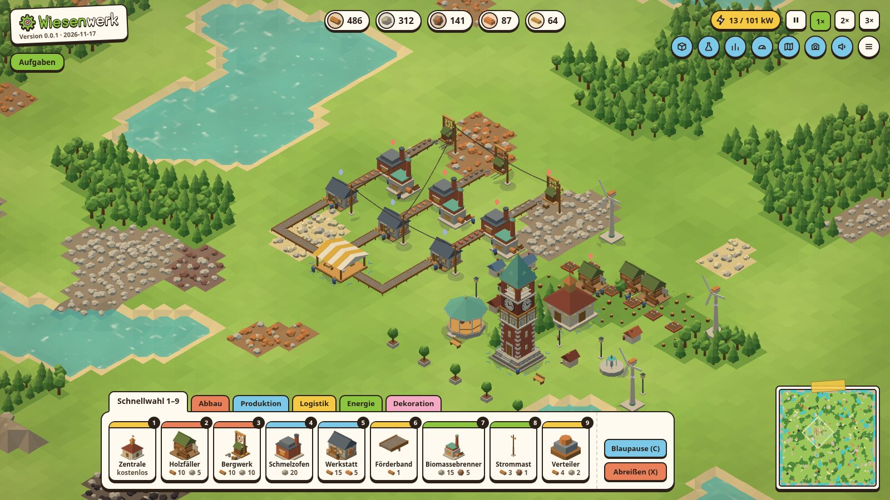
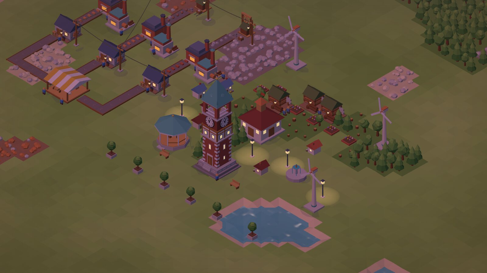
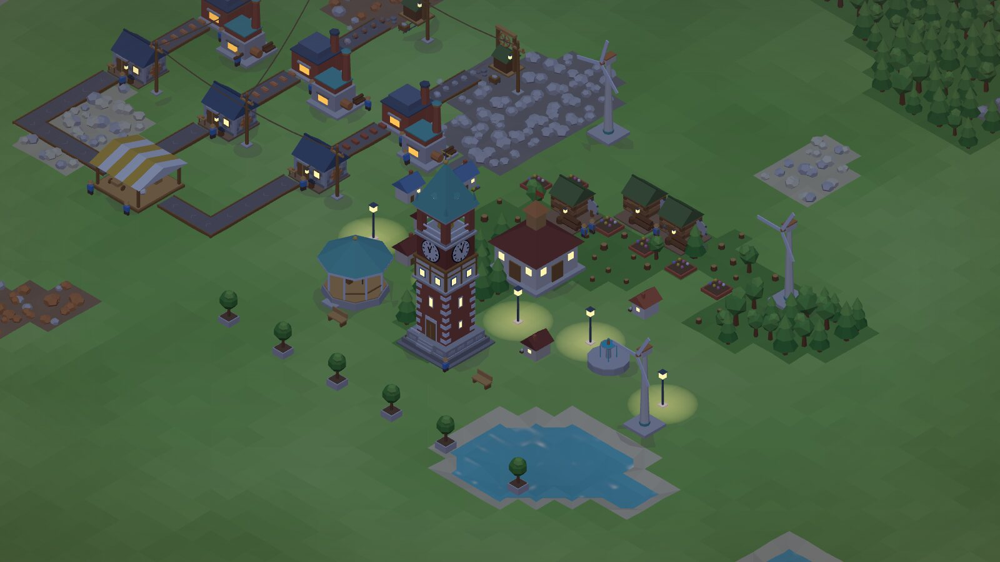

<p align="center">
  
</p>

<p align="center">
  <strong>Ein gemütliches Fabrikspiel für den Browser.</strong><br>
  Keine Gegner, kein Zeitdruck: nur eine grüne Wiese, Förderbänder und kleine Maschinen.
</p>

<p align="center">
  <a href="https://s84n.github.io/WiesenWerk/"><strong>▶&nbsp;&nbsp;Jetzt im Browser spielen</strong></a>
  &nbsp;·&nbsp; kostenlos, ohne Installation, ohne Anmeldung
</p>

<p align="center">
  
</p>

## Worum es geht

Du beginnst auf einer Wiese mit Wald, Steinen und ein paar Erzvorkommen. Zuerst fällst du
Bäume von Hand. Bald arbeiten Holzfäller und Bergwerke für dich, Förderbänder tragen Erz zu
Schmelzöfen, Werkstätten machen aus Barren Draht und Zahnräder, und Strommasten verbinden alles
zu einem Netz. Schritt für Schritt wächst daraus eine kleine Fabrik, die ganz von allein
läuft – und rund um deine Zentrale ein Dorf, dessen Bewohner tagsüber spazieren gehen.

Das große Ziel ist ein **Uhrturm**: Abschnitt für Abschnitt wünscht er sich die Waren deiner
Fabrik, und am Ende zeigt seine Uhr die echte Uhrzeit und läutet zur vollen Stunde.

## Gärten und Gemütlichkeit

Wiesenwerk soll sich nicht nach einer Reihe von Förderbändern anfühlen. Zwischen deinen Maschinen
legst du **Gemüsebeete, Blumenwiesen, Obstgärten und Gewächshäuser** an. Dort wachsen die
Pflanzen sichtbar heran: Keimlinge werden zu Kohlköpfen und Kürbissen, Apfelbäume blühen erst
rosa und tragen dann rote Äpfel. Gärtner gießen und ernten, Bienen summen vom Bienenstock zu den
Blüten.

- 🌻 **Gemütlichkeit lohnt sich:** Gärten, Bänke, Laternen und Zierbäume machen Maschinen in ihrer
  Nähe bis zu 10 % schneller – nur ein Bonus, nie eine Strafe.
- 🍎 **Garten-Waren:** Gemüse, Blumen, Äpfel und Honig kommen von selbst in den Vorrat. Die
  Backstube backt daraus Apfelkuchen, und jeder Kuchen lässt dein Dorf wachsen. Kompost aus dem
  Komposter verdoppelt die nächste Ernte.
- 🌿 **Natur erobert zurück:** Je länger ein Gebäude steht, desto mehr Gras, Blumen und Efeu wachsen
  an seinem Sockel. Wo die Arbeiter laufen, entsteht ein Trampelpfad.
- 🌹 **Hecken und Rosenbögen** ziehst du wie ein Band über deine Förderbänder – aus Bandstraßen
  werden grüne Alleen, die Ware läuft darunter weiter.
- 🍂 **Vier Jahreszeiten:** frisches Frühlingsgrün, buntes Herbstlaub mit wehenden Blättern und
  ein verschneiter Winter. Im Fotomodus wählst du die Jahreszeit frei.
- 🐑 **Tiere und kleine Überraschungen:** Schafe auf der Weide, Hühner vor den Dorfhäusern, eine
  Katze, die auf dem warmen Ofen döst, Igel in der Dämmerung und ein Regenbogen nach dem Regen.
- 🔥 **Dorffest:** An manchen Abenden – mit genug Apfelkuchen jeden Abend – feiert das Dorf mit
  Lichterketten, Lagerfeuer und Reigen.

<p align="center">
  
</p>

<table>
  <tr>
    <td width="50%"></td>
    <td width="50%"></td>
  </tr>
  <tr>
    <td align="center"><em>Winter im Garten</em></td>
    <td align="center"><em>Dorffest mit Lagerfeuer und Lichterketten</em></td>
  </tr>
</table>

<table>
  <tr>
    <td width="50%"></td>
    <td width="50%"></td>
  </tr>
  <tr>
    <td align="center"><em>Der Uhrturm als Langzeitziel</em></td>
    <td align="center"><em>Bauleiste, Vorrat und Minikarte</em></td>
  </tr>
</table>

## Was dich erwartet

- 🌾 **Eine eigene Welt für jedes Spiel:** Wälder, Seen, Felsen und Vorkommen von Kupfer, Eisen,
  Kohle und Sand – erzeugt aus einer Zahl, die du dir aussuchen kannst. Drei Kartengrößen.
- ⚙️ **Fabriken, die wirklich laufen:** Bergwerke, Schmelzöfen, Werkstätten, Manufakturen und
  Gießereien. Förderbänder in drei Stufen, Verteiler, Zusammenführer, Brücken, Tunnel und Lager.
- ⚡ **Strom selbst erzeugen:** Biomassebrenner, Windräder, Wasserräder, Solarfelder und
  Akku-Häuser, verbunden über Strommasten.
- 🔬 **Forschung:** Vom ersten Kupferbarren bis zu Stahlträgern, Uhrwerken und Messinstrumenten.
  Maschinen lassen sich in drei Stufen ausbauen.
- 🌱 **Gärten, Bienen und Backstube:** wachsende Beete und Obstgärten, Honig, Apfelkuchen und ein
  Dorf, das mit deinen Kuchen wächst.
- 📜 **Aufgaben in sieben Kapiteln**, die dich durch das ganze Spiel führen – als freundliche
  Angebote, nie als Pflicht.
- 🔍 **Engpass-Ansicht:** zeigt auf einen Blick, wo deine Fabrik stockt und warum.
- 📋 **Blaupausen, Rückgängig und Pipette**, damit Umbauen Spaß macht statt Arbeit.
- 🌅 **Tag und Nacht, Regen und kleines Leben:** goldene Nachmittage, Laternen am Abend,
  Vogelschwärme, Schmetterlinge und Enten auf dem See.
- 📷 **Fotomodus:** Oberfläche ausblenden, Tageszeit wählen und deine Fabrik als Bild speichern.

<table>
  <tr>
    <td width="50%"></td>
    <td width="50%"></td>
  </tr>
  <tr>
    <td align="center"><em>Abenddämmerung</em></td>
    <td align="center"><em>Nachts leuchten Fenster und Laternen</em></td>
  </tr>
</table>

## Steuerung

| Taste                 | Wirkung                                    |
| --------------------- | ------------------------------------------ |
| W A S D / Pfeiltasten | Kamera verschieben                         |
| Mausrad               | Zoomen                                     |
| Q / E                 | Kamera drehen                              |
| Linksklick            | Bauen, auswählen, von Hand abbauen         |
| Linksklick ziehen     | Förderbänder, Wege und Hecken bauen        |
| Rechtsklick / Esc     | Abbrechen, Fenster schließen, Menü         |
| R                     | Gebäude drehen                             |
| 1 – 9                 | Schnellwahl Gebäude                        |
| X                     | Abreißen                                   |
| C / Strg + V          | Blaupause kopieren / wieder einfügen       |
| F                     | Pipette: Gebäude unter der Maus übernehmen |
| Strg + Z              | Rückgängig                                 |
| T / I                 | Forschung / Statistik                      |
| V / B                 | Strom-Ansicht / Engpass-Ansicht            |
| M                     | Minikarte                                  |
| P                     | Fotomodus                                  |
| Leertaste             | Pause                                      |
| Strg + S              | Speichern                                  |

Die vollständige Liste steht im Spiel unter **Menü → Tastenbelegung**.

## Gut zu wissen

- **Spielstände** bleiben in deinem Browser auf deinem Gerät. Das Spiel speichert alle zwei
  Minuten automatisch. Über **Exportieren** sicherst du eine Fabrik als `.fabrik`-Datei, die du
  später wieder importieren oder einfach ins Fenster ziehen kannst.
- **Keine Werbung, keine Anmeldung, kein Tracking.** Das Spiel lädt nichts von fremden Servern.
- **Läuft am besten** in einem aktuellen Chrome, Edge oder Firefox am Computer. Die Grafik passt
  sich beim ersten Start automatisch an deinen Rechner an und lässt sich unter **Einstellungen**
  ändern.

## Selbst bauen

Wiesenwerk ist mit [three.js](https://threejs.org) und TypeScript geschrieben und wird mit
[Vite](https://vitejs.dev) gebaut. Voraussetzung ist [Node.js](https://nodejs.org) ab Version 20.

```bash
npm install      # Abhängigkeiten installieren
npm run dev      # Entwicklungsserver starten, dann http://localhost:5173 öffnen
npm test         # Tests der Spiellogik
npm run build    # Fertiges Spiel nach dist/ bauen
```

---

<p align="center">
  <br>
  <sub>© Wiesenwerk · Alle Rechte vorbehalten</sub>
</p>
